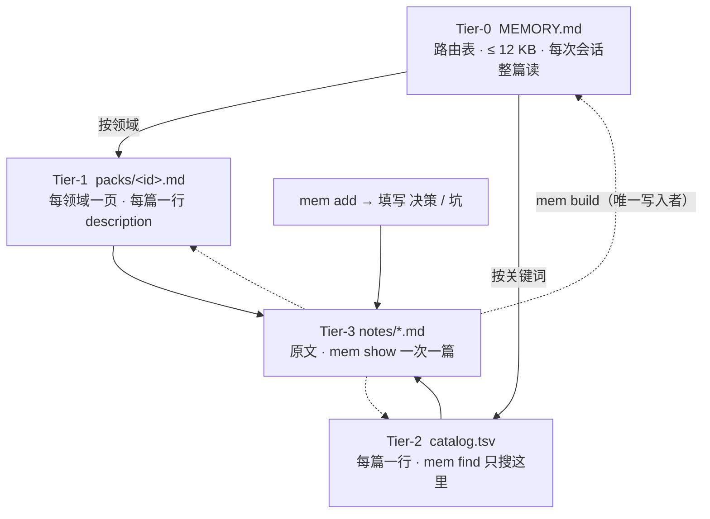

# Hippocampus 海马体

让 agent 吸取教训。踩过的坑写进硬盘，下次不再踩。

Coding agent 每开一个新会话都会忘掉上一次。比如上周查了 40 分钟才发现「部署脚本只切了软链接、没重启进程」，这周它会再查 40 分钟。用户纠正过一次的做法，换个会话它照犯。

Hippocampus 让每次踩坑都留下一篇 note，并保证下一次做同类任务之前，agent 先看到它。命令行工具叫 `mem`：纯 Markdown 加一个 TSV，一个约 550 行、只用标准库的 Python 脚本，没有数据库、没有向量、没有服务。

[让 agent 自己装好](#让-agent-自己装好) · [English](#english)

## 一个教训怎么走完一圈

**1. 栽了跟头，当场写下来。**

```bash
$ mem add release-vs-restart --type project --pack infra
~/.claude/memory/notes/2026-01-15-release-vs-restart.md
```

生成的文件已经有固定的骨架，agent 只需要填：

```markdown
---
name: 2026-01-15-release-vs-restart
description: 部署分两步：release.sh 只切软链接，restart.sh 才让新进程生效；验收看进程 cwd，不看软链接
metadata:
  type: project
  pack: infra
---

# 部署脚本只建 release，不重启服务

## FACT（现场证据）
- 跑完 release.sh 后 current -> releases/42，但 /proc/<pid>/cwd 仍是 releases/41。

## 决策／结论
- 上线 = release.sh && restart.sh。

## 坑（下次怎么避开）
- 软链接会骗人。验收看进程工作目录。
```

「决策」和「坑」两节是这篇 note 存在的理由。`description` 一句话是它以后能被找到的理由。

**2. 编译进索引。**

```bash
$ mem build
```

`build` 读遍 `notes/`，按关键词把这篇分进 `infra` 领域，然后重写三个文件：`catalog.tsv` 多了一行，`packs/infra.md` 多了一条，`MEMORY.md` 的「热档」里出现了它。这三个文件只由 `build` 写，agent 不手改。

**3. 下次同类任务，先查到上次怎么栽的。**

```bash
$ mem find 部署 restart
# 1 命中（只列前 1；全文：mem show <name>）
- [infra] 2026-01-15 部署脚本只建 release，不重启服务
    部署分两步：release.sh 只切软链接，restart.sh 才让新进程生效；验收看进程 cwd，不看软链接
    -> 2026-01-15-release-vs-restart.md
```

一行摘要通常就够了。要细节再 `mem show`。

## 写入纪律

教训能不能留下来，取决于 agent 写不写、写得能不能被找到。Hippocampus 把纪律写进提示词和规则段（`prompts/`），装好后放进你项目的 `AGENTS.md` 或 `CLAUDE.md`：

- **什么时候写**：做出一个可复用的结果；查明一个会再出现的问题的原因；被用户纠正一次；做了一个有理由的决定。当场写，不攒到会话末。
- **写什么**：FACT（命令、输出、路径、版本，能复现）、决策、坑。不写过程日志，不写 secret。
- **多大**：一篇一个主题，description 一句话说得清。同一件事有新进展，改原文，不新建「续」。
- **过期**：记忆和现场冲突，以现场为准，回头在原 note 里标「已失效」。不删除。
- **复盘**：较长的会话结束前，按 `prompts/proactive-build.md` 的六个问题过一遍。同一个坑出现三次，提炼成一条规则。

Claude Code 用户可以装 hooks：会话开始自动注入 `MEMORY.md`，第一次结束时提醒一次复盘，会话结束时自动 `build`。

## 常驻上下文恒定小

笔记会越积越多，但 agent 每个会话固定要读的只有 `MEMORY.md`。它有字节上限（默认 12 KB，超出 `build` 会警告），内容是：读写协定、领域表（每个领域什么时候该读）、最近 12 篇。



| 层 | 文件 | 内容 | 读法 |
|---|---|---|---|
| 0 | `MEMORY.md` | 协定、领域表、最近 12 篇 | 整篇读 |
| 1 | `packs/<id>.md` | 该领域每篇：日期、标题、description、路径 | `mem pack <id>` |
| 2 | `catalog.tsv` | `pack date type name title bytes gist` | `mem find <kw>` |
| 3 | `notes/*.md` | 原文 | `mem show <name>`，只读被指到的 |

两条硬规则：**索引不手改**，所以索引永远和原文一致；**原文不批量读**，所以上下文成本与笔记总数无关。

## 让 agent 自己装好

把下面这段原样发给你的 coding agent（Claude Code、Codex、Cursor 等），在你的项目目录里：

```text
请为当前项目安装 Hippocampus（让 agent 吸取教训的文件记忆，CLI 叫 mem）。
详细步骤见 https://raw.githubusercontent.com/tinchak0207/Hippocampus/main/docs/AGENT_INSTALL.md ，先读它再执行。要点：
1. git clone https://github.com/tinchak0207/Hippocampus.git ~/.local/share/hippocampus（已存在就 git pull --ff-only）。
2. 在该目录运行 ./install.sh --agents-file <本项目根目录>/AGENTS.md
   （项目用 CLAUDE.md 就换成 CLAUDE.md；两个都有就各传一次 --agents-file）。
   它会安装 mem、初始化记忆库（默认 ~/.claude/memory，已有内容一律保留）、把规则段追加到文件末尾（不改动已有内容，先备份）。
3. 如果我用的是 Claude Code，先问我要不要装 hooks；同意就再运行 ./install.sh --hooks。
4. 若 install.sh 提示 ~/.local/bin 不在 PATH，告诉我要改哪个 shell 配置文件，再加上。
5. 运行 mem doctor，应输出 VERDICT: OK；再按文档第 5 步做一次 add/find 闭环并删掉测试 note。
6. 回报：安装路径、MEM_HOME、改动过的文件和备份路径、mem doctor 的输出。
不要删除或覆盖任何已有文件。
```

不想交给 agent，就手动执行下一节。

## 安装

需要 Python ≥ 3.8 和 git。

```bash
git clone https://github.com/tinchak0207/Hippocampus.git
cd Hippocampus
./install.sh                                        # mem → ~/.local/bin，记忆库 → ~/.claude/memory
./install.sh --agents-file ~/code/myproj/AGENTS.md  # 把规则段追加进项目规则文件
./install.sh --hooks                                # Claude Code hooks（合并进 ~/.claude/settings.json，先备份）
./install.sh --skill-dir ~/.claude/skills/hippocampus  # 作为 Agent Skill 安装
./install.sh --examples                             # 放入 6 篇虚构示例 note
```

选项可以组合，重复执行是安全的：已有文件保留，规则段靠 `<!-- hippocampus:begin -->` 标记判断是否已追加，hooks 不会重复登记（没有改动时不写 settings.json、也不产生备份）。

自定义位置：

```bash
MEM_HOME=~/notes/agent-memory PREFIX=/usr/local ./install.sh
export MEM_HOME=~/notes/agent-memory   # 写进 shell 配置
```

`examples/` 是一个已 build 的虚构记忆库，可以先 `mem --root examples ls` 看看长什么样。

## 命令

| 命令 | 作用 |
|---|---|
| `mem add <slug> [--type T] [--pack ID] [--title S]` | 在 `notes/` 新建 `YYYY-MM-DD-<slug>.md`，带 front-matter 和「FACT / 决策 / 坑 / 相关」骨架；已存在则拒绝 |
| `mem build` | 重建 `catalog.tsv`、`packs/*.md`、`MEMORY.md`、`.memorypack/state.json`；幂等；超预算打 WARN |
| `mem find <kw>... [--pack ID] [--limit N]` | 在 catalog 每行里数关键词出现次数，按次数、再按日期排序；默认前 20；不返回原文 |
| `mem show <name>` | 打印 note；不是完整文件名时做 `*name*` 匹配，唯一命中才打印 |
| `mem pack <id>` | 打印 `packs/<id>.md` |
| `mem ls [pack]` | 无参数：各领域条目数；有参数：该领域的条目 |
| `mem doctor` | build 后检查：Tier-0 预算、断链、缺 description 或仍是模板占位、误写进 `notes/` 的索引文件、可选的旧库 symlink；有问题时 exit 1 |
| `mem sweep` | 把误写进 `notes/` 的 `MEMORY.md`、`README.md` 等移到 `archive/superseded/` |

全局参数 `--root DIR`，默认依次取 `$MEM_HOME`、`$MEMORY_ROOT`、`~/.claude/memory`。

## build 做了什么

1. 读 `.memorypack/packs.json`（缺失则只有 `misc` 一个领域）。
2. 对每篇 note：解析 front-matter；标题取正文第一个 `#`~`###` 标题，没有就用文件名；摘要取 `description`，没有就取正文第一段。
3. 日期：文件名中的 `YYYY-MM-DD` → `YYYYMMDD` → 最后一个合法 `MMDD` → 修改时间。
4. 分类：front-matter 的 `metadata.pack` 是合法 id 就用；否则在「文件名 + 标题 + 摘要 + 正文前 800 字」里计分，`strong` 每命中 +3，`keywords` 每命中 +1，最高分胜出，零分进 `misc`。
5. 按日期倒序写 `catalog.tsv`；删掉并重写所有 `packs/*.md`；写 `MEMORY.md`；写 `state.json`（篇数、未分类、缺 description、内容重复、各层字节数）。

## 配置：`.memorypack/packs.json`

| 键 | 默认 | 含义 |
|---|---|---|
| `packs[]` | `[]` | `{id, title, read_when, strong[], keywords[]}`；顺序即展示顺序与同分优先级 |
| `fallback` / `fallback_title` / `fallback_read_when` | `misc` | 未命中时的领域 |
| `router_budget_bytes` | 12000 | `MEMORY.md` 上限 |
| `pack_budget_bytes` | 32000 | 单个领域页上限 |
| `hot_count` | 12 | 路由表「热档」条数 |
| `gist_clamp` / `pack_gist_clamp` | 420 / 300 | 摘要截断长度 |
| `router_notes[]` | `[]` | 追加到路由表「写入协定」的自定义行 |
| `legacy_links[]` | `[]` | `{path, target}`；`doctor` 检查这些旧路径是否是指向本库的 symlink |

不要把 note 模板里的固定小节名（FACT、决策、坑、相关）放进关键词，否则所有 note 都会被分进同一个领域。

## 设计原则

- **教训优先**：模板逼着写「决策」和「坑」，而不是流水账。
- **单一真源**：只有 `notes/` 是写出来的，其余三层随时可以删掉重建。
- **预算优先**：每个会话的固定成本是一个有上限的文件。
- **可预测的检索**：子串计数，不做 embedding。找不到就换个更短的词。
- **不删除**：过期的标注过期，误写的移到 `archive/`。
- **工具无关**：CLI 和文件格式不依赖任何 agent；skill、规则段、hooks 只是接入方式。

## FAQ

**和直接往 AGENTS.md / CLAUDE.md 里加规则有什么区别？**
规则文件每次都整篇进上下文，加一条就贵一点，几百条之后就装不下了。Hippocampus 让规则文件只保留一段固定的「先查记忆、犯错后写记忆」，具体教训放在 `notes/`，按需取用。真正每次都要遵守的少数几条，再从 note 提升进规则文件。

**为什么不用向量检索？**
note 是 agent 自己写的，用词稳定，子串匹配够用且结果可复现。需要的话可以在 `catalog.tsv` 上另建语义索引，不影响这套结构。

**笔记多了 build 会慢吗？**
1400 篇、每篇约 2 KB 的合成数据，build 约 0.15 秒。

**可以手改 `MEMORY.md` 吗？**
下次 `build` 会覆盖。想改路由表，改 `packs.json`（`title`、`read_when`、`hot_count`、`router_notes`）或 note 的 `description`。

**多个 agent 共用？**
都指向同一个 `MEM_HOME`。各工具原来的记忆目录做成 symlink 指过来，写进 `legacy_links` 让 `doctor` 检查。

**分错领域怎么办？**
在 note 的 front-matter 写 `metadata.pack: <id>` 钉住；同类错误多了就调整 `packs.json` 的关键词。

**会把敏感信息写进去吗？**
规则段和提示词禁止写 secret，但工具本身不做过滤。记忆库要进 git，自己加一道扫描。

## 目录

```
SKILL.md              Agent Skill 入口（name: hippocampus）
AGENTS.md             给在本仓库开发的 agent 看的说明
scripts/mem           CLI（单文件 Python）
install.sh            安装 CLI、初始化 MEM_HOME、追加规则段、装 hooks
docs/AGENT_INSTALL.md 给 agent 执行的安装步骤
prompts/              写入纪律、会话末复盘、规则段、hooks 示例
templates/            空库模板、packs.json、note 与 pack 示例
examples/             虚构演示库（已 build）
tests/smoke.sh        端到端冒烟测试
```

## 致谢

最早在一个 AIGC 项目的日常开发里打磨出来：笔记从几十篇涨到上千篇，几个 agent 工具各自的记忆目录分叉过，后来合并成这套单一真源。

## License

MIT © VerenOwO

---

<a id="english"></a>

## English

Make your agent learn from its mistakes. Every pitfall goes to disk, so it is not hit twice.

Coding agents forget everything between sessions. The bug that took forty minutes to diagnose last week takes forty minutes again this week; a correction you gave once is ignored in the next session. Hippocampus turns each pitfall into a note and makes sure the agent sees it before the next task of the same kind. The CLI is `mem`: plain Markdown plus one TSV, a single ~550-line Python script using only the standard library. No database, no embeddings, no server.

### The loop

1. **Record it.** `mem add <slug> --type project|feedback|reference [--pack <id>]` creates `notes/YYYY-MM-DD-<slug>.md` with front-matter and fixed sections: FACT, Decision, Pitfall, Related. The one-line `description` is what makes it findable.
2. **Compile it.** `mem build` classifies every note into a domain and regenerates `catalog.tsv`, `packs/<id>.md`, and `MEMORY.md`. Only `build` writes these.
3. **Find it next time.** `mem find <keyword>` greps the catalog and returns one-line summaries; `mem show <name>` prints the full note.

### Constant, small resident context

The only file an agent reads every session is `MEMORY.md`, capped at 12 KB by default (`build` warns past the cap). It holds the read/write protocol, the domain table, and the 12 most recent notes. Everything else is fetched on demand. Two hard rules: never hand-edit the generated indexes; never bulk-read `notes/`.

### Let your agent install it

Paste this into Claude Code, Codex, Cursor, or any coding agent, from your project directory:

```text
Install Hippocampus (file-based lessons memory for coding agents; CLI: mem) for this project.
Read https://raw.githubusercontent.com/tinchak0207/Hippocampus/main/docs/AGENT_INSTALL.md first, then:
1. git clone https://github.com/tinchak0207/Hippocampus.git ~/.local/share/hippocampus (git pull --ff-only if it exists).
2. In that directory run ./install.sh --agents-file <project root>/AGENTS.md (use CLAUDE.md if that is what the project uses; pass both if both exist).
3. If I use Claude Code, ask me whether to install hooks; if yes, run ./install.sh --hooks.
4. If install.sh says ~/.local/bin is not on PATH, tell me which shell config to change, then add it.
5. Run mem doctor (expect VERDICT: OK), then do the add/find round trip from step 5 of the doc and remove the test note.
6. Report the install path, MEM_HOME, every file changed with its backup path, and the mem doctor output.
Do not delete or overwrite any existing file.
```

### Manual install

```bash
git clone https://github.com/tinchak0207/Hippocampus.git && cd Hippocampus
./install.sh [--agents-file PATH] [--hooks] [--skill-dir DIR] [--examples]
```

Python ≥ 3.8. Idempotent; never overwrites existing files. Prompts, the rules snippet, and CLI output are in Chinese.

### License

MIT © VerenOwO
